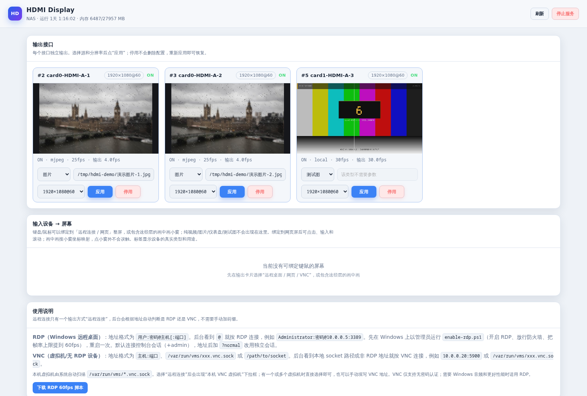
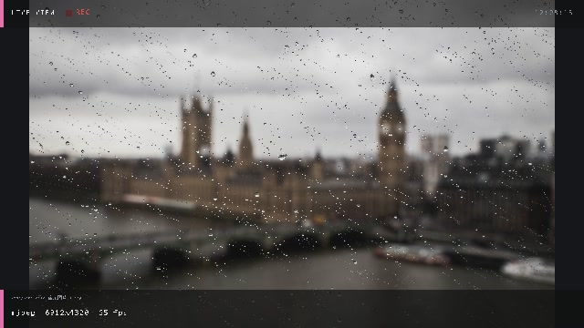
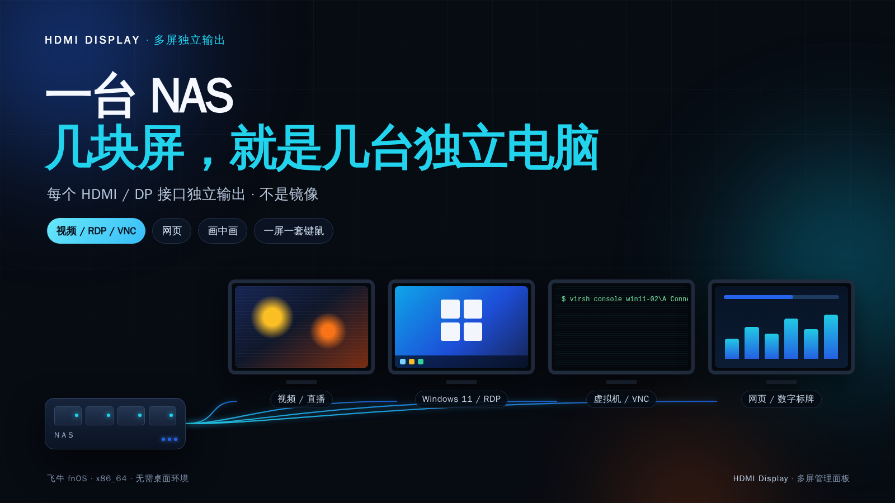
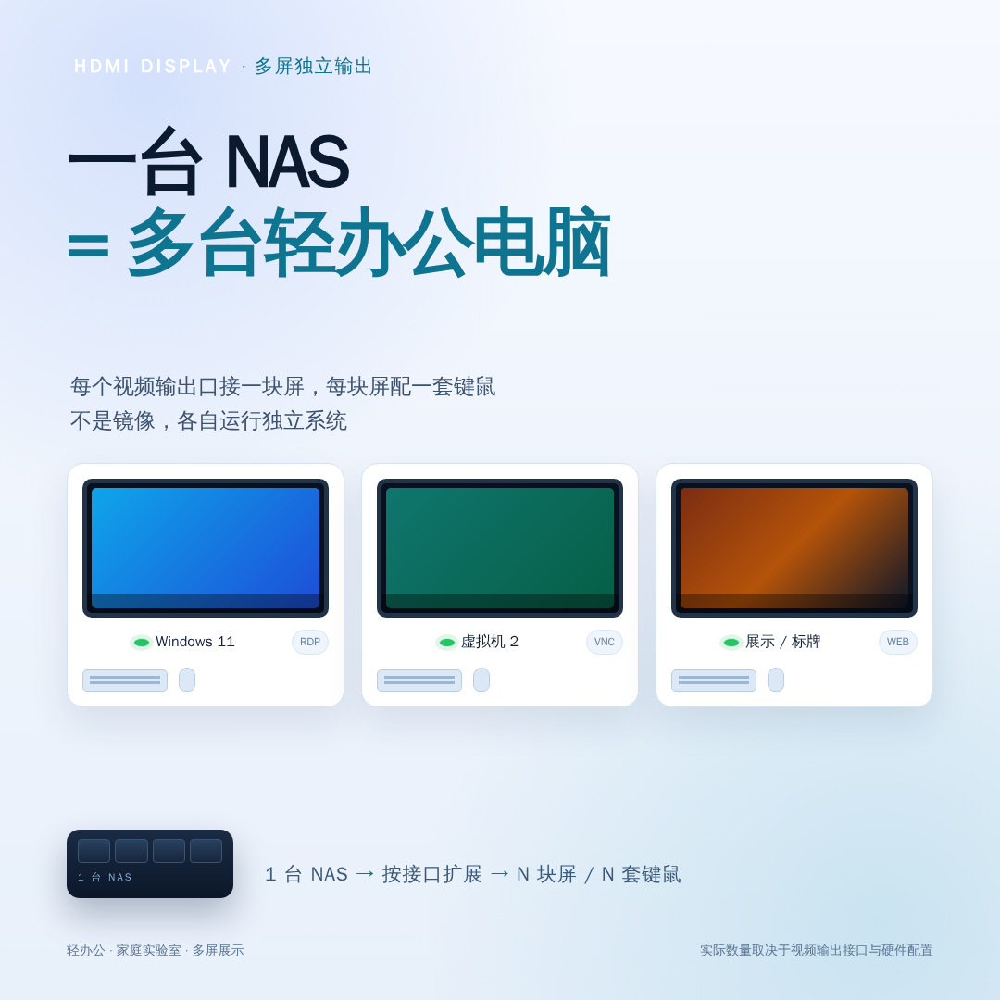
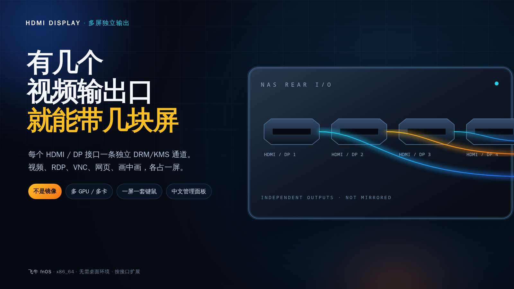
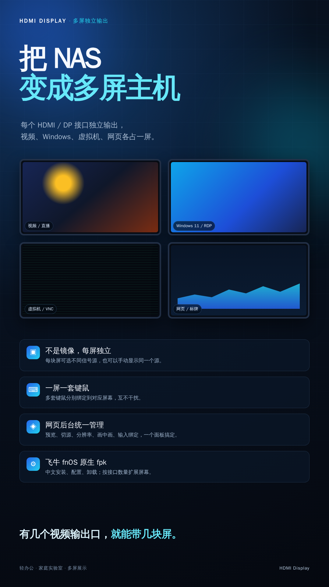

# HDMI Display

**一台 NAS，接几块屏，就是几台独立电脑。**

HDMI Display 是给 fnOS / Debian 12 用的多屏独立输出工具：每个 HDMI/DP 接口
一条独立 DRM/KMS 管线，可以分别显示视频、图片、Windows RDP、VNC 虚拟机控制台、
网页、画中画、仪表盘或测试图。不需要桌面环境，通过内置中文网页后台统一管理。

[](https://github.com/XG-China/hdmi-display/releases)
[](LICENSE)
[]()

> 图文版功能介绍：[marketing/INTRO.md](marketing/INTRO.md)

## 界面截图

网页管理面板：每块屏一张卡片，独立预览、信号源、分辨率、应用/停用。



视频 HUD / 中文路径显示：



宣传图（可直接用于发布）：

| 主视觉 | 多席位办公 |
|---|---|
|  |  |

| 按输出接口扩展 | 竖版 |
|---|---|
|  |  |

宣传文案和可编辑的 HTML/CSS 源文件在 [`marketing/`](marketing/)。

## 它解决什么问题

普通 NAS 通常只有一块 HDMI，或者只用来做“显示器镜像”。HDMI Display 把每个
视频输出接口当成一条独立通道：

```text
NAS
 ├─ HDMI 1 → 视频/直播
 ├─ HDMI 2 → Windows 11 RDP
 ├─ HDMI 3 → 虚拟机 VNC 控制台
 ├─ HDMI 4 → 网页/监控/数字标牌
 └─ 每个接口可再配一套键鼠
```

- **不是镜像**：每块屏可以显示不同内容。
- **按接口扩展**：机器有几个可用视频输出口，就能带几块屏（受 GPU CRTC、带宽、
  接口数量和硬件限制）。
- **一套后台**：切换信号源、分辨率、画中画、键鼠绑定都在网页里完成。
- **没有桌面也能跑**：直接 DRM/KMS，不依赖 Xorg/GNOME/KDE。

## 典型场景

### 1. 多虚拟机小办公

在 NAS 上创建多个 Windows 11 虚拟机，每个虚拟机分配一块显示器和一套键鼠：

- A1 → Win11 VM 1（RDP）
- A2 → Win11 VM 2（RDP 或 VNC）
- A3 → Win11 VM 3（RDP）
- A4 → 网页/监控/标牌

适合轻办公、浏览器、Office、ERP、网页系统。Windows 虚拟机的正式办公授权需要
自行确认；视频剪辑、CAD、3D、游戏不适合。

### 2. 家庭实验室 / 多屏控制台

- Proxmox / libvirt / QEMU 虚拟机控制台
- Linux 服务器桌面
- 多台 Windows 主机
- 一路视频 + 一路虚拟机 + 一路监控 + 画中画

### 3. 数字标牌 / 展示

- 不同屏幕播放不同视频/图片
- 网页看板、菜单、监控页面
- 一块屏做主画面，画中画叠加小窗

### 4. 旧设备再利用

- 旧 NAS / 小主机 + 多块显示器
- 不需要为每块屏再买一台电脑

## 功能

| 功能 | 说明 |
|---|---|
| 多输出 | 每块已连接屏幕独立管理 |
| 多 GPU | 扫描 `/dev/dri/card*`，支持多张显卡 |
| 信号源 | 视频/直播、图片、本机画面、远程连接、网页、画中画、仪表盘、测试图 |
| 远程连接 | 一个选项，后台自动识别 RDP / VNC |
| 本机虚拟机 | 自动扫描 `/var/run/vms/*.vnc.sock`，多台可选 |
| 键鼠绑定 | 每套键盘/鼠标绑定到对应屏幕 |
| 画中画 | 主画面 + 小窗，坐标映射，键盘跟随层 |
| 中文 UI | 中文网页面板、中文安装/配置/卸载向导、中文 HUD |
| 硬件解码 | VAAPI H.264/HEVC 等，软件解码回退 |
| 音频 | 媒体音频、RDP 音频走对应 HDMI PCM |
| 生命周期 | 安装=打开，停止=启用，升级/改配置保持原状态 |
| 打包 | 自带最小 FFmpeg/FreeRDP 依赖，约 31 MB |

## 内容源

| 类型 | 参数 | 说明 |
|---|---|---|
| `media` | `rtsp://...`、`http(s)://...`、`/path/a.mp4` | 视频/流/文件 |
| `image` | `/path/a.jpg` 或 URL | 静态图片 |
| `remote` | `用户:密码@主机[:端口]`、`主机:端口`、`/var/run/vms/xxx.vnc.sock` | 自动识别 RDP/VNC |
| `vnc` | `host:5900`、`/var/run/vms/x.vnc.sock` | 旧配置兼容 |
| `web` | `https://example.com` | 网页/看板（Xvfb + Chromium） |
| `pip` | `media:URL｜vnc:HOST:PORT｜x,y,w,h` | 画中画 |
| `ui` | 空 | 仪表盘 |
| `bars` | 空 | 测试图 |

远程连接规则：

- 地址含 `@`：`用户:密码@主机[:端口]` → **RDP**
- 地址是 `主机:端口`、socket 或普通路径 → **VNC**
- 旧地址的 `RDP:` / `VNC:` 前缀仍兼容，但不再是必填
- RDP 默认连接控制台会话（`+admin`）；地址后加 `?normal` 改用独立会话
- VNC 目前只支持无认证，建议只走本机 socket 或可信内网

每个输出启动时先显示测试图，之后由用户在面板里选择信号源。

## 架构

```
media/image/remote/web/pip
        │
  每屏独立解码/采集线程
        │
  XRGB 画布（HUD/画中画/文字）
        │
  DRM/KMS atomic: connector → CRTC → plane
```

- 每块屏一个线程、一个解码器/采集器、一个画布，互不影响。
- 视频用最小化 FFmpeg（VAAPI 硬解，软件回退）。
- RDP 用原生 libfreerdp，解码到 DRM 帧缓冲；音频走 HDMI PCM。
- VNC 用内置 RFB 客户端，直接读虚拟机 socket。
- 网页源用 Xvfb + Chromium，x11grab 采集，XTEST 注入键鼠。
- 看门狗：长时间无出帧自动重开源；systemd 负责进程拉起。

## 硬件建议

| 项目 | 建议 |
|---|---|
| CPU | x86_64，支持 VT-x/AMD-V；多 VM 时核心越多越好 |
| 内存 | 1 台 Win11 建议 8–12 GB；3 台建议 32–48 GB |
| 显卡 | 有多个 HDMI/DP 输出；核显/独显均可；VAAPI 可硬解 |
| 存储 | SSD/NVMe 放虚拟机磁盘，机械盘做备份 |
| 输出 | 实际数量取决于接口、CRTC、带宽和分辨率/刷新率 |
| 系统 | fnOS / Debian 12 / Linux DRM/KMS |

Windows 11 虚拟机需要 TPM（swtpm）和 UEFI（OVMF）。正式办公请确认 Windows
授权方式。

## 安装

### fnOS App Center

1. 从 [Releases](https://github.com/XG-China/hdmi-display/releases) 下载
   `hdmi-display_<version>.fpk`。
2. 在 fnOS App Center 手动安装。
3. 安装完成应用会显示“打开”并运行。
4. 浏览器打开 `http://<NAS>:8080/`，或通过 fnOS 桌面应用入口打开。

安装/配置向导是中文的，可设置：

- 网页管理面板端口
- `appliance-compositor` 停止策略
- 网页源依赖 `xvfb + chromium` 一键 apt 安装

### 网页源依赖

只有“网页源”需要额外安装：

```bash
sudo apt update
sudo apt install -y --no-install-recommends xvfb chromium
```

约 300–450 MB。视频、图片、RDP、VNC、画中画、本机画面不需要。

## 使用

1. 打开面板，给每块屏选择源类型和参数。
2. 点“应用”。
3. 需要键盘鼠标时，把设备绑定到对应屏幕：
   - 整屏 RDP/VNC/网页
   - 包含这些层的画中画
4. 点“停止”会停用该输出；不会删除已保存配置。
5. 切换源类型时会自动填入该屏幕、该方式上一次成功使用的地址。
6. 未使用过的类型只显示输入提示，不会带入旧内容。

### RDP

Windows 端建议先运行 `enable-rdp.ps1`（开启 RDP、放行防火墙、提高帧率上限），
然后填写：

```text
用户:密码@主机[:端口]
```

默认 `+admin` 控制台会话；需要独立会话时加 `?normal`。

### VNC / 本机虚拟机

- 选择“远程连接”后会出现“本机 VNC 虚拟机”下拉框。
- 自动扫描 `/var/run/vms/*.vnc.sock`，一台或多台虚拟机直接选择。
- 也可以手动填写 `主机:端口` 或 socket 路径。

### 画中画

格式：

```text
主源|小源|x,y,w,h
```

例如：

```text
media:/movies/a.mp4|vnc:/var/run/vms/demo.vnc.sock|1280,720,480,270
```

主层支持视频/图片/RDP/VNC/网页；叠加层支持 VNC/网页/视频/图片。
键鼠会根据指针最后进入的层转发。

## 网页后台 / API

- 直接入口：`http://<NAS>:8080/`
- fnOS 网关：`/app/hdmi-display`，管理员 iframe，使用 `app.sock`
- 8080 被占用不影响网关

| 方法 | 路径 | 说明 |
|---|---|---|
| GET | `/api/state` | JSON（outputs、inputs、vnc_hosts） |
| GET | `/api/apply?out=NAME&type=T&arg=..&w=..&h=..` | 启用/切换源 |
| GET | `/api/disable?out=NAME` | 停用 |
| GET | `/api/input/bind?id=DEV&out=NAME` | 绑定键鼠（空 out = 解绑） |
| GET | `/api/quit` | 退出 |
| GET | `/preview/NAME.mjpg` | MJPEG 预览 |
| GET | `/snapshot/NAME.jpg` | 单帧 JPEG |

## fnOS 生命周期

- **安装完成 = 打开**：应用立即运行，App Center 显示“打开”。
- **用户点停止 = 启用**：`stop + disable`，后台不运行、不开机自启。
- **点启用 = 打开**：`enable + start`。
- **更新 / 改配置保持原状态**：原来“打开”就继续运行，原来“启用”就保持停止。
- **设置持久化**：端口和 appliance-compositor 策略保存，升级不重置。
- **卸载**：删除 unit、drop-in、socket、runtime、Chromium 临时 profile；
  默认同时删除配置、应用数据和 app 目录（可选择保留）。

## 从源码编译

`build-kit/` 提供可移植编译环境，换电脑后可直接编译 fpk：

```bash
# Docker（Windows 用 build-kit\build-in-docker.ps1）
bash build-kit/build-in-docker.sh

# 或 Debian 12 / fnOS 原生
sudo bash build-kit/setup-debian.sh
bash packaging/build-fpk.sh
```

Docker 镜像包含 Debian 12、FreeRDP 3、最小 FFmpeg 5.1.8、fnpack；FFmpeg
源码已内置在 `build-kit/vendor/`。详见 [`build-kit/README.md`](build-kit/README.md)。

依赖：

```bash
sudo apt install build-essential pkg-config libdrm-dev \
    freerdp3-dev winpr3-dev libssl-dev libx11-dev libxtst-dev
```

## 性能与稳定性

测试环境：3 个已连接输出。

- 测试图：30.0 fps
- 中文路径图片：3.95–3.98 fps（图片按 4 Hz 刷新）
- CPU：约 29–32%
- RSS：193 MB 左右，三次采样稳定
- 当前 RDP 实例：60 fps，CPU 约 25%，60 秒 RSS 227.9→228.1 MB
- 全量 `-Wall -Wextra` 编译无警告
- Debian 12 容器 `ldd` ALL_FOUND

字库为 Noto Sans CJK SC 16×16 点阵，查表绘制，不引入 FreeType/TTF
运行时开销。

## 已知限制

- 输出数量取决于 GPU 接口/CRTC/带宽，不是软件固定值。
- RDP 密码以明文保存在本机配置，仅建议可信内网。
- RDP 剪贴板当前未开启；办公场景需要后续补充。
- VNC 只支持无认证。
- 输入设备在应用启动时扫描；新增键鼠后需要重启服务。
- 网页源 Chromium 以 `--no-sandbox` 运行，只加载可信网页。
- 单 NAS 是单点故障；重要办公建议 UPS、快照和备份。
- 视频会议、USB 摄像头、独立 USB 耳机路由目前不是强项。
- 画中画小窗的输入只对 VNC/网页/RDP 层生效。

## 故障排查

**屏幕黑屏 / 无法启动**
- 检查 `journalctl -u hdmi-display -n 100`
- 看是否提示 `not DRM master`；如有，停止 X/桌面/compositor
- fnOS 有 `appliance-compositor` 时，在配置里选“停止它”

**网页源黑屏**
- 安装 `xvfb` + `chromium`
- 确认 URL 可访问
- 查看 `/tmp/hdmi-web-*` 和 journal

**RDP 连不上**
- 确认 Windows 已开启远程桌面、防火墙放行
- 地址格式 `用户:密码@主机[:端口]`
- 需要独立会话时加 `?normal`

**键鼠不出现**
- 设备需在应用启动前插好
- 只有 RDP/VNC/网页或包含这些层的画中画才会显示可绑定屏幕
- 需要 root 或 `input` 组权限

## 安全

- 应用以 root 运行（DRM master、`/dev/input`、ALSA）。
- 面板默认监听 `0.0.0.0:8080`，不要直接暴露公网。
- 建议用防火墙/VLAN/VPN；需要时加 `--web-token`。
- 详见 [SECURITY.md](SECURITY.md)。

## 第三方组件与许可证

本项目使用 **GPL-3.0-or-later**，见 [LICENSE](LICENSE)。

- FFmpeg 5.1.8：LGPL-2.1-or-later，最小构建，库可替换
- FreeRDP / WinPR：Apache-2.0
- Noto Sans CJK SC：SIL OFL 1.1
- X11/XCB/libdrm/OpenSSL/ALSA 等：各自上游许可证

完整说明见 [THIRD_PARTY_NOTICES.md](THIRD_PARTY_NOTICES.md)。

## 链接

- GitHub：<https://github.com/XG-China/hdmi-display>
- Releases：<https://github.com/XG-China/hdmi-display/releases>
- 宣传文案：[marketing/PROMO.md](marketing/PROMO.md)
- 宣传图源文件：[marketing/](marketing/)
