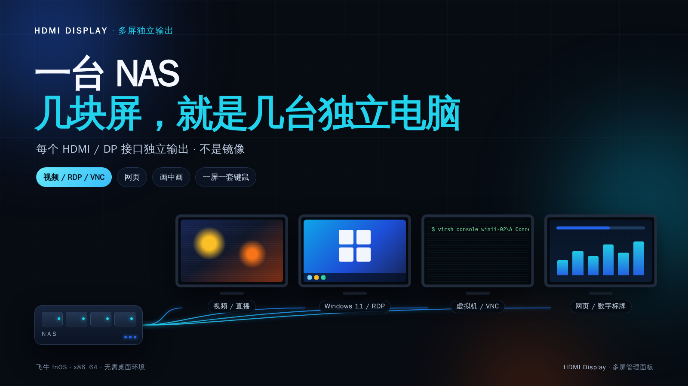
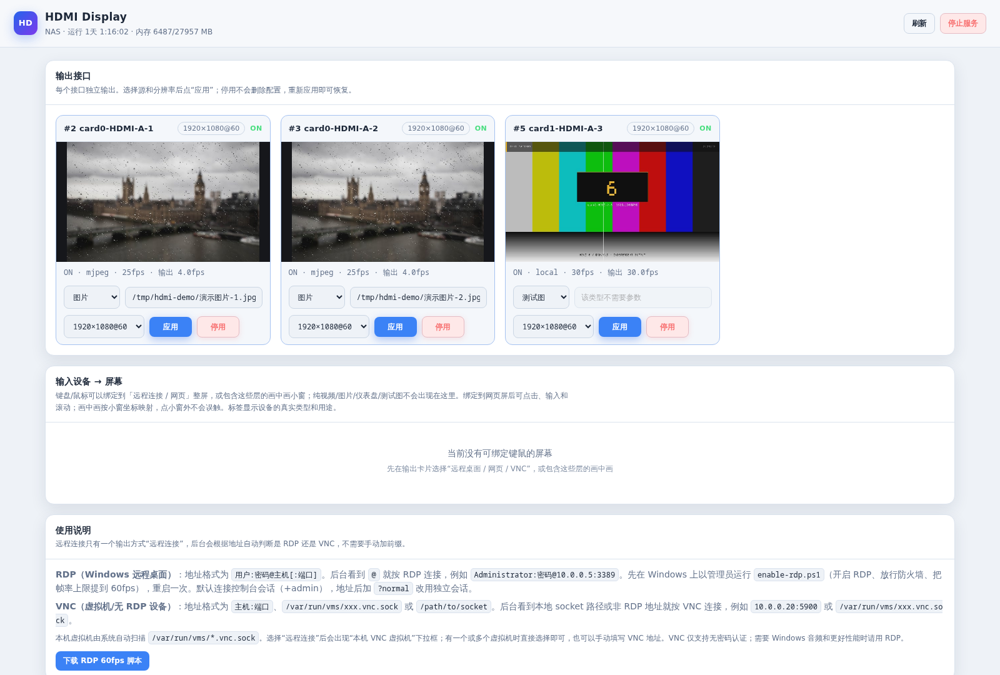
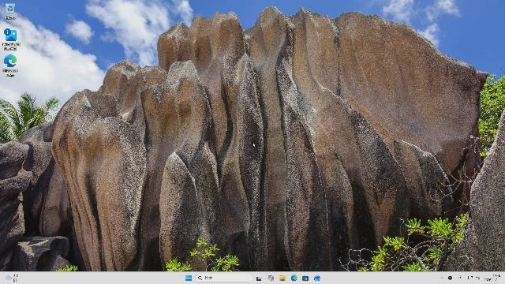
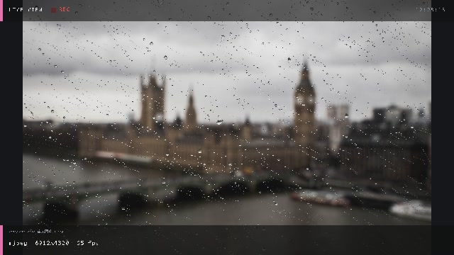
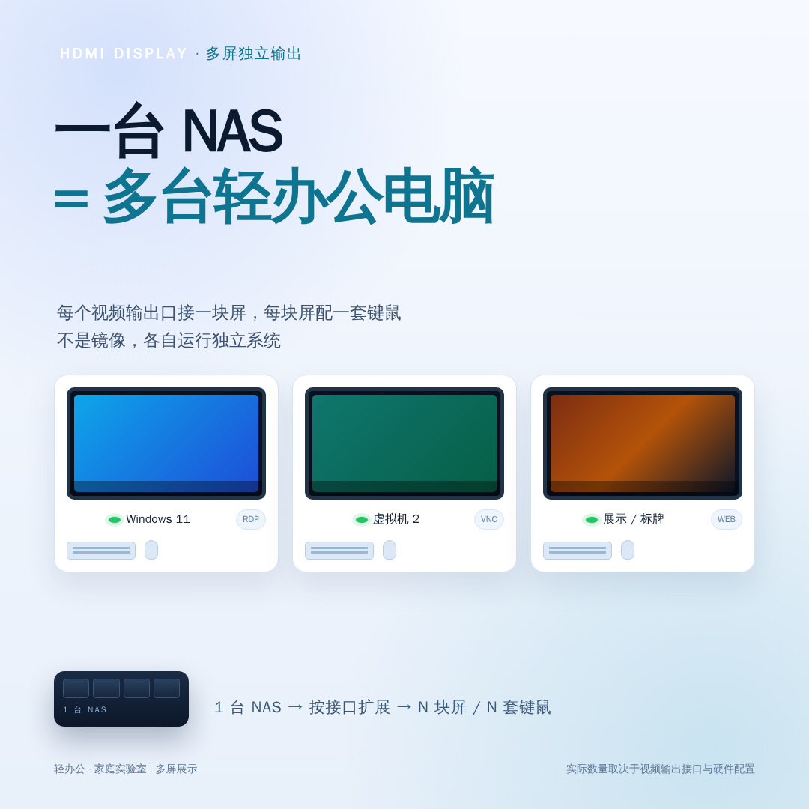
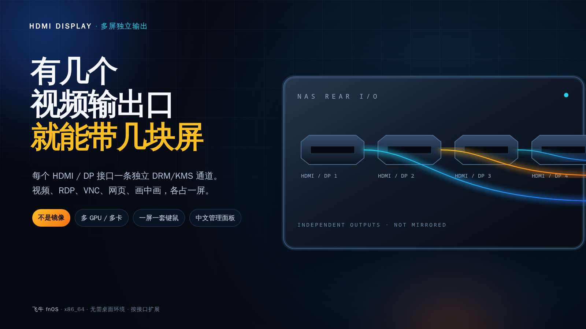
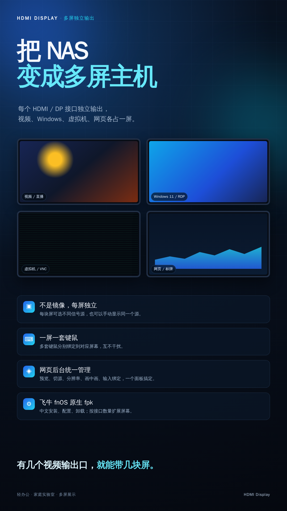

# 一台 NAS，接几块屏，就是几台独立电脑

> HDMI Display 图文介绍 · 多屏独立输出 / RDP / VNC / 网页 / 视频 / 画中画
>
> 按三部分整理：使用和功能、界面截图、代码架构。



---

## 一、使用和功能介绍

### 一句话介绍

HDMI Display 把飞牛 fnOS / Debian NAS 变成一台多屏主机：

- 每个 HDMI/DP 输出接口独立显示不同内容
- 视频、图片、Windows RDP、VNC 虚拟机、网页、画中画各占一屏
- 每块屏可以配一套键盘鼠标
- 全部通过中文网页后台管理，不需要桌面环境

**不是镜像，不是窗口铺满，而是每个接口一条独立的 DRM/KMS 输出通道。**

### 功能一：每个视频输出口都是独立通道

- 机器有几个可用 HDMI/DP 接口，就能带几块屏
- 每块屏独立选择信号源，也可以手动让多块屏显示同一个源
- 支持多张显卡 / 多卡输出
- 实际数量取决于 GPU 接口、CRTC、带宽和分辨率/刷新率

### 功能二：一个网页后台管理所有屏幕

- 每块屏一张卡片：状态、分辨率、预览、信号源、应用/停用
- 支持实时 MJPEG 预览和单帧截图
- 切换源类型时自动填入该屏幕、该方式上一次成功使用的地址
- 输入设备区只显示可绑定键鼠的屏幕
- 支持 fnOS 网关和直接 HTTP 端口访问

### 功能三：远程桌面 RDP / VNC 自动识别

后台不再要求手动选 RDP 或 VNC，直接填地址：

- `用户:密码@主机[:端口]` → 自动按 **RDP**
- `主机:端口` → 自动按 **VNC**
- `/var/run/vms/xxx.vnc.sock` → 自动按 **VNC**

本机虚拟机自动扫描：

- 扫描 `/var/run/vms/*.vnc.sock`
- 一台或多台虚拟机出现在“本机 VNC 虚拟机”下拉框
- 选择后自动填入 socket 路径
- 也可以手动填写远程 VNC 地址

RDP 默认连接控制台会话（`+admin`）；地址后加 `?normal` 改用独立会话。
VNC 目前只支持无认证，建议只走本机 socket 或可信内网。

### 功能四：一屏一套键鼠，多套互不干扰

- 每套键盘/鼠标可以绑定到不同输出
- 适合“一台 NAS + 多台 Windows 虚拟机”的小型轻办公
- 画中画按小窗坐标映射，点小窗外不会误触
- 键盘跟随指针最后进入的层
- 设备通过 `/dev/input/by-id/*` 或 `/dev/input/event*` 读取

### 功能五：视频、图片、本机画面、网页

- **视频/直播**：RTSP、HTTP、HLS、本地文件
- **图片**：本地路径或 URL
- **本机画面**：X11 桌面或 `/dev/fb0` 控制台
- **网页**：Xvfb + Chromium，适合看板、监控、网页系统
- **画中画**：主画面 + 小窗叠加
- **仪表盘 / 测试图**：本机绘制，不依赖外部源

网页源需要额外安装：

```bash
sudo apt install -y --no-install-recommends xvfb chromium
```

视频、图片、RDP、VNC、画中画、本机画面不需要额外依赖。

### 功能六：中文 HUD 和等待界面

- 视频/图片/画中画启动后显示 HUD，约 4 秒自动隐藏
- 中文路径正常显示，使用 Noto Sans CJK SC 16×16 点阵
- 生僻字/繁体/emoji 显示为 `?`
- RDP/网页/VNC 镜像不叠加视频 HUD

### 功能七：fnOS 生命周期

- 安装完成 = **打开**，应用立即运行
- 用户点停止 = **启用**，执行 `stop + disable`，后台不运行
- 点启用 = **打开**，执行 `enable + start`
- 更新 / 改配置保持原状态：原来运行就重启，原来停止就保持停止
- 卸载删除 unit、drop-in、socket、runtime、Chromium 临时 profile；
  默认同时删除配置、应用数据和 app 目录

### 适合谁

- 有 NAS、有多块显示器，想统一管理多路输出
- 想用一台 NAS 跑多个 Windows 11 虚拟机做轻办公
- 家庭实验室：多台 VM、多屏、多套键鼠
- 数字标牌、监控、网页看板
- 需要 RDP/VNC 多屏控制台

### 不适合谁

- 视频剪辑、CAD、3D、游戏等高负载场景
- 对单点故障零容忍的生产办公
- 没有多视频输出接口的 NAS
- 需要 HDR/高刷/多路 4K 的极端场景（取决于硬件）

### 多虚拟机轻办公示例

```text
NAS
 ├─ Win11 VM 1 → HDMI 1 → 显示器 1 + 键鼠 1
 ├─ Win11 VM 2 → HDMI 2 → 显示器 2 + 键鼠 2
 ├─ Win11 VM 3 → HDMI 3 → 显示器 3 + 键鼠 3
 └─ 网页/监控 → HDMI 4
```

建议：

- Win11 虚拟机使用 UEFI + TPM（swtpm）
- 每台 VM 建议 8–12 GB 内存
- 3 台 VM 建议 32–48 GB 主机内存
- 虚拟机磁盘放 SSD/NVMe
- 正式办公请确认 Windows 授权

### 获取与安装

- GitHub：<https://github.com/XG-China/hdmi-display>
- Releases：<https://github.com/XG-China/hdmi-display/releases>

安装：

1. 下载 `hdmi-display_<version>.fpk`
2. 在 fnOS App Center 手动安装
3. 打开 `http://<NAS>:8080/`
4. 给每块屏选择信号源

---

## 二、界面截图和使用截图

### 网页管理面板

每块屏一张卡片：状态、分辨率、预览、信号源、应用/停用。



### Windows 11 远程桌面

通过 RDP 输出到独立 HDMI 接口，使用 `hdmi` 账号登录；桌面、任务栏和键鼠
都走这块屏，不是屏幕镜像。



### 视频 HUD / 中文路径

视频/图片/画中画启动后显示 HUD，中文路径正常显示，约 4 秒自动隐藏。



### 宣传图

| 主视觉 | 多席位办公 |
|---|---|
|  |  |

| 按输出接口扩展 | 竖版 |
|---|---|
|  |  |

---

## 三、代码和架构介绍

> 完整逐文件代码导读：[docs/CODE.md](../docs/CODE.md)

### 总架构

```text
media/image/remote/web/pip
        │
  每屏独立解码/采集线程
        │
  XRGB 画布（HUD/画中画/文字）
        │
  DRM/KMS atomic: connector → CRTC → plane
```

- 每块屏一个线程、一个解码器/采集器、一个画布，互不影响
- 视频用最小化 FFmpeg，VAAPI 硬解，软件回退
- RDP 用原生 libfreerdp，解码到 DRM 帧缓冲
- VNC 用内置 RFB 客户端，直接读虚拟机 socket
- 网页源用 Xvfb + Chromium，x11grab 采集，XTEST 注入键鼠
- 看门狗：长时间无出帧自动重开源；systemd 负责进程拉起

### 源码模块

| 模块 | 作用 |
|---|---|
| `main.c` | 多屏调度、源生命周期、HUD、画中画、输入路由、看门狗、Web 回调 |
| `drm_display.c` | DRM/KMS atomic 后端，多卡、connector/CRTC/plane、双缓冲 |
| `video_dec.c` | FFmpeg 视频/图片/本机画面/网页采集、VAAPI、音频解码 |
| `vnc_source.c` | 内置 RFB/VNC 客户端，Raw/CopyRect/DesktopSize |
| `rdp_source.c` | 原生 libfreerdp RDP，NLA、AVC444、光标、键鼠、音频 |
| `web_source.c` | Xvfb + Chromium kiosk，XTEST 键鼠注入 |
| `input_router.c` | evdev 扫描、分类、绑定、键鼠事件归一化 |
| `alsa_out.c` | ALSA 动态加载、HDMI PCM/ELD 检测、IEC958 |
| `rdp_audio.c` | FreeRDP rdpsnd 私有后端 |
| `draw.c` + `font*.c` | XRGB 画布、测试图、仪表盘、中文点阵字库 |
| `config.c` | 行式配置读写、原子保存、输入绑定 |
| `web_server.c` + `web/` | HTTP 服务、JSON API、MJPEG/JPEG 预览、中文面板 |
| `packaging/` | fpk、manifest、systemd、安装/升级/卸载生命周期 |
| `build-kit/` | Docker/Debian 可移植编译环境 |

### 线程模型

| 线程 | 职责 |
|---|---|
| 主线程 | 参数、热插拔、Web 命令队列、看门狗、配置保存 |
| `screen_thread` | 每块活动输出一个，取最新帧、绘制、`disp_present()` |
| 视频解码线程 | 每个视频/图片/本机画面/网页源一个 |
| VNC 线程 | 每个 VNC 源一个 |
| RDP 线程 | 每个 RDP 源一个 |
| 音频线程 | 每个媒体音频源一个 |
| Web 客户端线程 | 每个 HTTP 连接一个 |

### 关键设计

- **最新帧模型**：解码线程不排队，只保留最新帧，降低延迟
- **shadow buffer**：绘制先写普通 RAM，再一次性拷贝到 DRM dumb buffer
- **稳定输出名**：`cardN-CONNECTOR`，热插拔后不变
- **热插拔恢复**：拔线关闭、插回自动恢复；用户主动停止不会被覆盖
- **看门狗**：10 秒无出帧或 RDP 断线时重开源
- **配置原子写**：临时文件 + fsync + rename
- **单实例锁**：`flock` 防止两个进程抢 DRM master

### 扩展入口

- 加内容源：改 `main.c` 的 `open_layer()`/`classify()`，新建
  `xxx_source.c/.h`，在 `screen_t`、`screen_sync()`、`screen_thread()`、
  `route_input()` 和 `Makefile` 里接入
- 加 Web API：在 `web_server.c` 加路由，在 `web_ops` 加回调，在
  `main.c` 实现，在 `web/app.js` 调用
- 加显示后端：实现 `display.h` 的 `disp_*` 接口，并在 `Makefile` 选择
  `DISPLAY_SRC`
- 加字库：ASCII 改 `font8x16.c`；中文重新生成 `font_cjk.c` 的 16×16 表

更完整的逐文件说明、线程/锁、DRM 选路、RDP/VNC/网页源细节见
[docs/CODE.md](../docs/CODE.md)。

---

## 安全提示

- 应用以 root 运行（DRM master、`/dev/input`、ALSA）
- RDP 密码明文保存在本机配置，仅建议可信内网
- VNC 目前只支持无认证
- 面板不要直接暴露公网，建议防火墙/VPN
- Chromium 以 `--no-sandbox` 运行，只加载可信网页

## 许可证

GPL-3.0-or-later。第三方组件见
[THIRD_PARTY_NOTICES.md](../THIRD_PARTY_NOTICES.md)。
